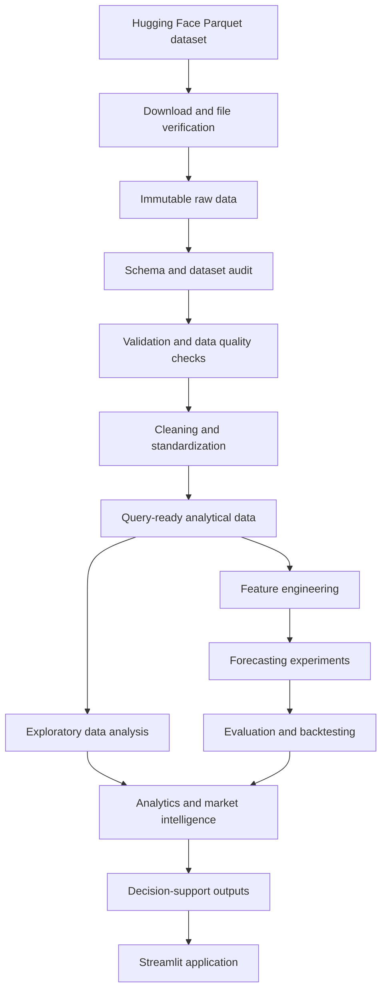

# MandiLens India

**An Intelligent Agricultural Market Analytics, Price Forecasting & Decision-Support Platform**

MandiLens India is a planned end-to-end data science and machine learning platform for exploring agricultural market prices across India. It is designed to turn a large historical mandi-price dataset into useful national, state, district, commodity and market-level insights, and eventually support price forecasting and market comparisons.

> **Project status:** Initial development / foundation stage. Capabilities described as planned below should not be interpreted as completed or deployed features. Implementation status will be updated as individual project files are created and verified.

---

## Table of contents

- [Project overview](#project-overview)
- [Problem statement](#problem-statement)
- [Objectives](#objectives)
- [Dataset](#dataset)
- [Planned capabilities](#planned-capabilities)
- [Technology stack](#technology-stack)
- [Planned architecture](#planned-architecture)
- [Repository structure](#repository-structure)
- [Getting started](#getting-started)
- [Working with the full dataset](#working-with-the-full-dataset)
- [Machine learning methodology](#machine-learning-methodology)
- [Visualizations and generated artifacts](#visualizations-and-generated-artifacts)
- [Development roadmap](#development-roadmap)
- [Data quality and integrity principles](#data-quality-and-integrity-principles)
- [Limitations and considerations](#limitations-and-considerations)
- [Contributing](#contributing)
- [License](#license)

---

## Project overview

Agricultural market prices vary across commodities, markets, districts, states and time. Historical market observations can be used to study these differences, understand seasonal patterns, investigate price volatility and build forecasting experiments where sufficient history is available.

MandiLens India aims to provide a unified workflow for:

1. Acquiring and auditing the complete available historical dataset.
2. Validating, cleaning and standardizing records without altering the original source files.
3. Exploring agricultural market behaviour at multiple geographical and commodity levels.
4. Engineering time-aware features for forecasting experiments.
5. Comparing baseline, statistical and machine learning forecasting approaches.
6. Presenting analytical results through an interactive application.
7. Developing evidence-based market comparison and decision-support capabilities.

The project is intended as a reproducible data science and machine learning engineering system, not merely a collection of charts or a single prediction notebook.

## Problem statement

Agricultural price information can be difficult to interpret when observations are distributed across many markets, commodities, locations and dates. A large historical dataset creates an opportunity for systematic analysis, but its scale also introduces engineering challenges: data integrity, schema discovery, memory-efficient processing, missing observations, duplicate records, inconsistent category names and reliable time-series evaluation.

MandiLens India addresses these challenges through a documented data pipeline and analytical workflow. It will preserve the complete source dataset while producing validated, queryable data for analysis and modelling.

## Objectives

- Build a nationwide agricultural market analytics layer.
- Analyse historical commodity prices over time.
- Compare prices across states, districts and markets.
- Study commodity seasonality and price volatility.
- Develop forecasting baselines and machine learning experiments.
- Evaluate models using chronological validation and time-series backtesting.
- Build an intelligent mandi comparison experience.
- Integrate weather and agricultural production context when suitable, documented sources are identified.
- Develop decision-support outputs with transparent assumptions.
- Deliver an interactive Streamlit dashboard.
- Maintain reproducible experiments, tests and technical documentation.

## Dataset

### Primary source

The planned primary dataset is hosted on Hugging Face:

**[Mandi India Daily Prices — Hugging Face dataset](https://huggingface.co/datasets/DHIVAKARNAIDUSUNKARI/mandi-india-daily-prices-2001-2026)**

The dataset publisher reports the following characteristics:

| Attribute | Publisher-reported information |
|---|---|
| Approximate number of records | 75.96 million |
| Historical coverage | 2001–2026 |
| File format | Parquet |
| Yearly files | 26 |
| Geographic coverage | Indian states and union territories, as available in the source |
| Data dimensions | Market, district, commodity and variety-level information, as available in the source |

These figures are **source-reported and have not yet been independently verified by this project**. The actual file inventory, schema, data types, date coverage and total row count will be established during the data-source audit and download-verification stages.

### Dataset handling policy

- Use the complete available dataset for the national master-data layer.
- Do not arbitrarily restrict the master dataset to selected states, districts or commodities.
- Preserve original Parquet files as immutable raw inputs.
- Verify downloaded files and record counts before downstream processing.
- Inspect the actual schema before writing column-dependent transformations.
- Profile missing values, duplicate records and price relationships.
- Do not fabricate missing historical observations.
- Do not assume that fields such as arrivals, weather or production are present unless the schema confirms them.
- Record the source and transformation history of derived datasets.

Before redistributing source data or derived extracts, review the dataset's current license and terms on its Hugging Face page. This project README does not grant rights to the source dataset.

## Planned capabilities

The following capabilities are part of the intended project scope. They will be marked as implemented only after their code and outputs have been verified.

### 1. Nationwide market analytics

- National-level market summaries.
- State-wise and district-wise comparisons.
- Commodity and variety exploration.
- Market-level historical price analysis.
- Time-based filtering and aggregation.

### 2. Seasonality and volatility analysis

- Monthly and seasonal price patterns.
- Historical price dispersion and volatility measures.
- Comparisons across commodities and markets.
- Identification of data gaps and irregular observation patterns.

### 3. Price forecasting

- Baseline forecasting methods.
- Statistical time-series experiments.
- Machine learning models, including Random Forest, XGBoost, LightGBM and CatBoost where appropriate.
- Commodity-specific and broader model experiments where supported by the data.
- Chronological validation, rolling backtests and model comparison.
- Forecast explainability and documented limitations.

Forecasting eligibility will be assessed for each commodity-market series. The project will not assume that every combination has enough observations to support a reliable forecast.

### 4. Mandi comparison and decision support

- Comparison of available market price observations.
- Ranking and signal-generation experiments with transparent criteria.
- Net-realization analysis only where appropriate cost inputs are available and their assumptions can be documented.
- Recommendations presented as decision support, not guarantees of future prices or profit.

### 5. Weather and agricultural context

Weather and production information may be integrated through additional documented data sources. Such integration depends on source availability, compatible geography and dates, licensing and data quality. No weather or production fields are assumed to exist in the primary mandi dataset.

### 6. Interactive application

A Streamlit application is planned to bring the analytical outputs together through pages for India-wide overview, mandi exploration, commodity analytics, geographical analysis, price forecasting, mandi comparison, decision support and methodology.

## Technology stack

The following is the intended technology stack. Individual tools will be introduced when they serve a clear project requirement.

| Area | Planned technologies |
|---|---|
| Programming | Python |
| Data analysis | Pandas, NumPy |
| Large-scale data processing | Polars, PyArrow, DuckDB |
| Storage and interchange | Parquet |
| Visualization | Matplotlib, Seaborn, Plotly |
| Statistical analysis | Statsmodels |
| Machine learning | Scikit-learn, XGBoost, LightGBM, CatBoost |
| Application | Streamlit |
| Optional API layer | FastAPI |
| Testing | Pytest |
| Development | Jupyter Notebook, VS Code, Git, GitHub |

The stack is a plan, not a claim that every dependency is already installed or used. Unnecessary infrastructure and libraries will be avoided.

## Planned architecture



This diagram represents the target workflow. The final architecture may be adjusted as the source schema, storage requirements and implementation constraints become clear.

## Repository structure

The following is the planned high-level repository layout. Directories and files will be added progressively as the development roadmap advances.

```text
MandiLens-India/
│
├── README.md
├── .gitignore
├── requirements.txt
├── pyproject.toml
├── .env.example
│
├── config/
│   ├── project_config.yaml
│   ├── data_sources.yaml
│   ├── commodity_categories.yaml
│   ├── data_quality.yaml
│   ├── model_config.yaml
│   └── dashboard_config.yaml
│
├── data/
│   ├── raw/                 # Original source files; never modified
│   ├── interim/             # Intermediate processing outputs
│   └── processed/           # Validated analytical datasets
│
├── notebooks/               # Exploration and experiments
│
├── src/
│   └── mandilens/
│       ├── ingestion/
│       ├── data_engineering/
│       ├── dimensions/
│       ├── analytics/
│       ├── features/
│       ├── models/
│       ├── decision_support/
│       └── utils/
│
├── scripts/                  # Repeatable command-line workflows
├── app/                      # Streamlit application
│   ├── components/
│   └── pages/
│
├── artifacts/                # Models, metrics, forecasts and reports
├── images/                   # Saved charts and visual assets
├── reports/                  # Generated HTML reports
├── tests/                    # Automated tests
├── docs/                     # Technical documentation
└── .github/
    └── workflows/            # CI and scheduled workflow definitions
```

The directory layout is a planning convention. Actual directories will be created when their first files or outputs are needed. Large raw datasets, generated models, secrets and local environment files should not be committed to Git unless there is a deliberate and appropriate reason.

## Getting started

### Prerequisites

- Python installed on your system.
- Git installed and available from the terminal.
- Sufficient local storage for the full source dataset and derived outputs.
- A supported Python version will be specified when the project dependency configuration is finalized.

The full dataset is large. Check available disk space before downloading it. The project will use DuckDB and/or Polars for large-scale operations rather than loading the entire dataset into a Pandas DataFrame.

### 1. Clone the repository

After the repository has been created and its remote URL is known, clone it with:

```bash
git clone <YOUR_REPOSITORY_URL>
cd MandiLens-India
```

Replace `<YOUR_REPOSITORY_URL>` with the actual Git repository URL. No repository URL has been assumed in this README.

### 2. Create a virtual environment

**Windows PowerShell:**

```powershell
python -m venv .venv
.venv\Scripts\Activate.ps1
```

**macOS / Linux:**

```bash
python -m venv .venv
source .venv/bin/activate
```

### 3. Install project dependencies

Once `requirements.txt` has been created and populated, install the dependencies with:

```bash
python -m pip install --upgrade pip
python -m pip install -r requirements.txt
```

The exact dependency versions and supported Python version will be documented in the project configuration. Do not treat this initial README as a verified environment lockfile.

### 4. Start the development environment

Jupyter Notebook will be used for data exploration and experiments. After the notebook dependencies have been installed, start Jupyter with:

```bash
jupyter lab
```

The first environment and dataset-audit notebooks will be added during Phase 2.

### 5. Run the dashboard

The Streamlit application will be runnable after its application files, data dependencies and configuration are implemented. The intended command is:

```bash
streamlit run app/Home.py
```

This command is a future run instruction; it will become usable once `app/Home.py` has been created and the required application dependencies are installed.

## Working with the full dataset

A dataset of this size requires deliberate storage and query choices.

- Keep downloaded source Parquet files in the raw-data area and do not edit them in place.
- Use file-level checks, schema inspection and row-count verification during ingestion.
- Use DuckDB for analytical SQL queries directly over Parquet where suitable.
- Use Polars for efficient columnar transformations where suitable.
- Use Pandas for smaller samples, summaries and compatible downstream workflows—not as the default container for the entire source dataset.
- Prefer column selection, predicate pushdown, partition-aware reads and aggregated outputs.
- Keep intermediate and processed outputs separate from raw inputs.
- Persist data-quality findings and dataset inventories for reproducibility.

Processing strategies will be selected after the actual Parquet layout, schema and local hardware constraints are inspected.

## Machine learning methodology

Forecasting experiments will follow a time-aware evaluation process:

1. Define the forecasting target only after inspecting and documenting the source schema.
2. Establish data eligibility rules for each series, including observation count and continuity checks.
3. Build simple baseline forecasts before testing more complex models.
4. Split observations chronologically; do not randomly mix future observations into training data.
5. Use rolling or expanding-window backtesting where appropriate.
6. Compare models using documented metrics and consistent evaluation windows.
7. Check for data leakage, missing periods and changes in market coverage.
8. Record model configuration, training data window, evaluation results and limitations.
9. Present forecasts with clear context; do not describe estimates as guaranteed future prices.

Model selection will depend on empirical results. No model performance or accuracy is claimed at this stage.

## Visualizations and generated artifacts

Project outputs will be organized so that experiments remain reproducible and the repository stays manageable.

- Save relevant charts in suitable subdirectories under `images/`.
- Save interactive Plotly charts as HTML where they add value.
- Save trained models, evaluation metrics, forecasts and generated analytical reports under `artifacts/` or `reports/`, according to their purpose.
- Save cleaned and analytical datasets in their designated `data/` locations.
- Avoid huge notebook displays and unnecessary local absolute paths in notebook output.
- Use meaningful, consistent filenames and document how important outputs were generated.

Large generated files should generally be stored outside Git or managed through an appropriate artifact-storage strategy.

## Development roadmap

Development is planned across nine phases:

| Phase | Focus |
|---|---|
| 1 | Project foundation and configuration |
| 2 | Environment setup and full dataset acquisition |
| 3 | Data engineering, validation and standardization |
| 4 | Nationwide exploratory data analysis |
| 5 | Feature engineering |
| 6 | Machine learning and price forecasting |
| 7 | Advanced market intelligence and decision support |
| 8 | Streamlit application |
| 9 | Testing, documentation and finalization |

The detailed file-by-file roadmap is maintained in the project development plan. Files will be considered complete only after their creation and execution have been verified. The roadmap may be adjusted when implementation evidence justifies a change.

## Data quality and integrity principles

MandiLens India will follow these principles throughout development:

- Preserve source data and provenance.
- Verify downloads before processing.
- Inspect real columns and data types rather than assuming a schema.
- Identify duplicates and investigate missing observations.
- Validate date fields and available price relationships.
- Keep transformations explicit, documented and reproducible.
- Avoid fabricating observations or unsupported fields.
- Keep evaluation chronological for forecasting tasks.
- Record limitations and assumptions alongside analytical outputs.

## Limitations and considerations

- Publisher-reported dataset size and coverage still require independent verification.
- The actual meaning, units, completeness and consistency of every source column must be established through schema and data-quality audits.
- Not every commodity-market combination will necessarily have enough historical observations for forecasting.
- Historical patterns do not guarantee future market prices.
- Weather and production analyses require separate, compatible and appropriately licensed data sources.
- Net-realization or profitability comparisons require reliable cost inputs; observed market prices alone are not sufficient to establish a farmer's final realized return.
- Dashboard insights and recommendations will depend on the quality, coverage and freshness of their underlying data.

## Contributing

The project is being developed incrementally. Before contributing changes:

1. Review the project structure and relevant documentation.
2. Keep raw data immutable.
3. Follow the existing configuration, logging, typing and validation conventions.
4. Add or update tests for reusable functionality.
5. Document data transformations and modelling assumptions.
6. Avoid committing credentials, local environments or large raw datasets.

Contribution guidelines may be expanded once the repository workflow is established.

## License

The repository's software license has not yet been selected. Until a license is added, do not assume that the project's code is granted under an open-source license. The Hugging Face dataset is separately governed by its own license and terms; consult the dataset source before using or redistributing it.

---

**MandiLens India** — building a more analytical view of India's agricultural markets, one verified data step at a time.
